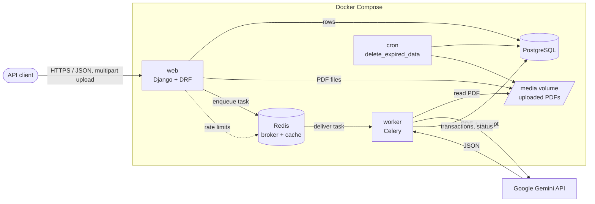
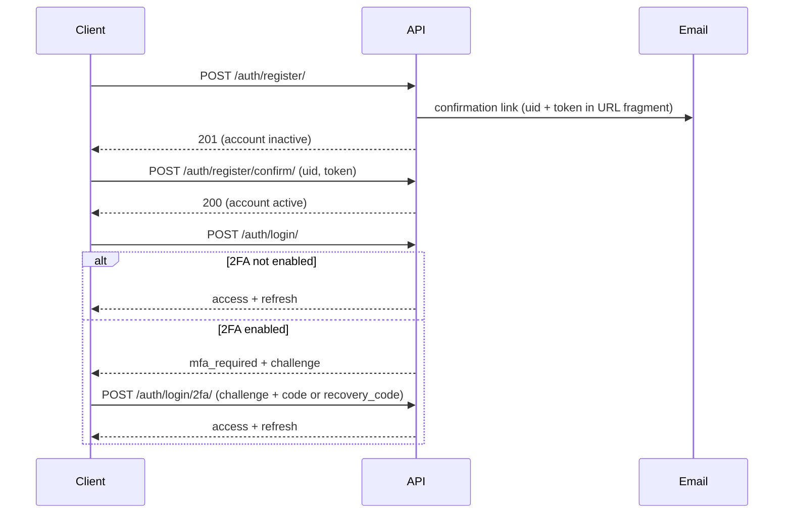
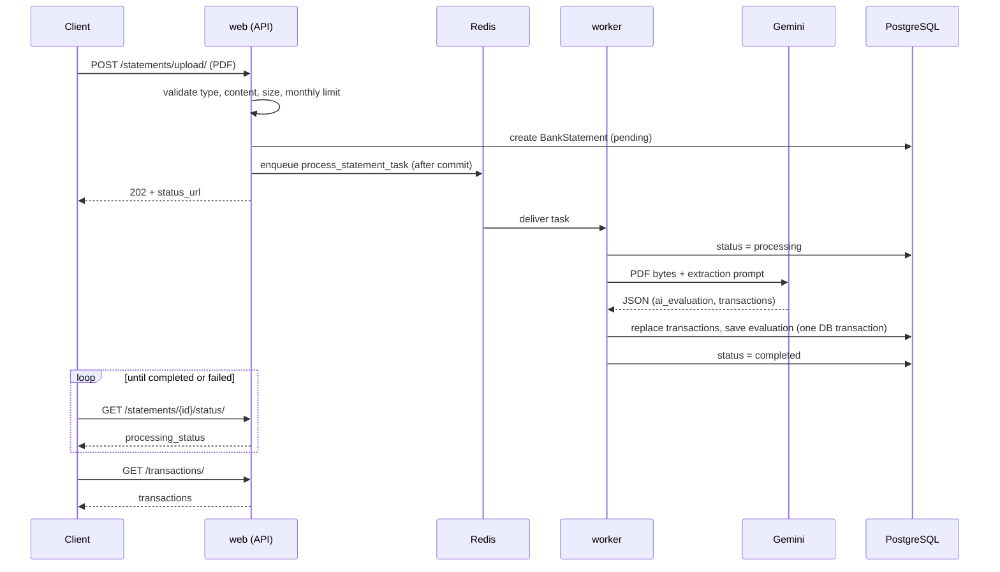

<div align="center">

# Statement AI

### A REST API that reads bank statement PDFs, categorizes every transaction with Google Gemini, and writes a short financial summary

<p>
  
  
  
  
  
  
  
  
</p>

<p>
  <b>JWT Auth + optional 2FA</b> &nbsp;•&nbsp;
  <b>Async PDF processing</b> &nbsp;•&nbsp;
  <b>AI categorization</b> &nbsp;•&nbsp;
  <b>Per-user data isolation</b> &nbsp;•&nbsp;
  <b>Retention &amp; erasure tooling</b>
</p>

<p>
  <a href="#introduction">Introduction</a> ·
  <a href="#quickstart">Quickstart</a> ·
  <a href="#features">Features</a> ·
  <a href="#architecture">Architecture</a> ·
  <a href="#getting-started">Getting Started</a> ·
  <a href="#configuration">Configuration</a> ·
  <a href="#api-reference">API Reference</a> ·
  <a href="#core-workflows">Workflows</a> ·
  <a href="#data-handling-and-security">Security</a> ·
  <a href="#development-and-testing">Development</a> ·
  <a href="#docker-and-deployment">Deployment</a> ·
  <a href="#project-structure">Structure</a> ·
  <a href="#troubleshooting">Troubleshooting</a>
</p>

</div>

<br>

## Introduction

Bank statements arrive as PDFs, and a PDF is hard to do anything with. Statement AI takes that PDF, sends it to Google Gemini, and stores what comes back as structured data: one record per transaction with a date, an amount, a counterparty, a transaction type and a spending category, plus a short plain-English evaluation of the statement as a whole. Everything is served through a JWT-secured REST API.

It is a backend only. There is no web UI; you talk to it with `curl`, Postman, or your own frontend. It is aimed at developers who want to build a personal-finance tool, a budgeting app or a data pipeline on top of statement data without writing their own PDF extraction.

What the API does today:

- Registers users with email confirmation, optional TOTP two-factor authentication, and password reset by email.
- Accepts PDF uploads (up to 10 MB) and processes them in the background through a Celery worker.
- Extracts and categorizes transactions with Gemini, and stores them per user.
- Lets users list, filter, search and sort their transactions, and read the AI summary of each statement.
- Lets users download their original PDF, export their data as JSON, and delete statements or their whole account.
- Cleans up old data on a schedule, and keeps usage records and an audit log for operators.

What it does not do: it does not parse PDFs locally (the whole file goes to Gemini), it does not edit transactions, and it does not compute numeric statistics such as monthly totals. The "analytics" endpoint returns the AI-written summaries only. See [Known limitations](#known-limitations).

## Documentation

A longer set of guides lives in the `docs/` directory and is published with GitHub Pages. Treat this README as the reference for the current code; where the two disagree, trust the README and the source.

- [Documentation home](https://unq0de.github.io/statement_ai/)
- [Getting started guide](https://unq0de.github.io/statement_ai/getting-started/)
- [Installation guide](https://unq0de.github.io/statement_ai/installation/)
- [Features overview](https://unq0de.github.io/statement_ai/features/)
- [API reference](https://unq0de.github.io/statement_ai/api-reference/)
- [Security and privacy](https://unq0de.github.io/statement_ai/security/)
- [Troubleshooting](https://unq0de.github.io/statement_ai/troubleshooting/)

---

## Quickstart

You need Docker with Docker Compose and a [Google Gemini API key](https://aistudio.google.com/apikey).

**1. Clone the repository**

```bash
git clone https://github.com/unq0de/statement_ai.git
cd statement_ai
```

**2. Create your environment file**

```bash
cp .env.example .env
```

Set `SECRET_KEY` and `GEMINI_API_KEY`. Keep `DEBUG=1` for local work.

> **Check `DATA_RETENTION_DAYS` before you start.** `.env.example` sets it to `1`, so the daily cleanup job would delete every statement older than one day. Set it to something sensible (the application default is `365`) unless you want that behavior.

**3. Start the stack**

```bash
docker compose up -d --build
```

This starts the web API, a Celery worker, a cron container, Redis and a local PostgreSQL. A one-off `migrate` service applies database migrations first; if a migration fails, the other application services do not start.

**4. Check that it is up**

```bash
curl -i http://localhost:8001/api/statements/
```

A `401 Unauthorized` response means the API is running and enforcing authentication. There is no dedicated health endpoint.

**5. Create an admin user** *(optional, for `/admin/`)*

```bash
docker compose exec web python manage.py createsuperuser
```

The API is at `http://localhost:8001/api/`. The [Core workflows](#core-workflows) section walks through register, confirm, log in, upload and read.

---

## Features

### Accounts and authentication

Registration creates an inactive account and sends a confirmation email with a one-time link. The account cannot log in until the link has been used. A resend endpoint exists, and it answers identically whether or not an unconfirmed account exists for the address, so it cannot be used to probe for registered emails. Password reset works the same way.

Login returns a short-lived access token (60 minutes) and a refresh token (1 day). Tokens carry two revocation markers: a hash of the password, so a password change or reset invalidates every existing token, and an `auth_version` counter that is bumped when two-factor authentication is enabled or disabled.

Optional TOTP two-factor authentication works with any authenticator app. Users enable it by confirming a password, scanning a secret, and entering a first code. They receive recovery codes (10 by default) that are shown once. When 2FA is on, login returns a short-lived challenge instead of tokens, and the client completes it with either an authenticator code or a recovery code. TOTP secrets are stored encrypted, a code can only be used once, and a challenge is burned after too many wrong attempts. The whole feature can be turned off with `TWO_FACTOR_ENABLED=0`, in which case its endpoints answer `404`.

The password policy is configurable: minimum length (12 by default), similarity to username or email, common passwords, all-numeric passwords, and a requirement for at least one punctuation mark or symbol. Accounts whose password no longer satisfies the current rules can still prove they know it, but are refused tokens until they reset it.

### Statement upload and processing

An upload is validated, stored, and acknowledged immediately with `202 Accepted`. The actual AI work happens in a Celery task, so a slow Gemini call never blocks an HTTP request. Clients poll a status endpoint until the statement is `completed` or `failed`. The task retries failures up to three times with exponential backoff, and each statement has a visible `processing_status` (`pending`, `processing`, `completed`, `failed`). The full pipeline is described in [Statement processing pipeline](#statement-processing-pipeline).

An optional per-user monthly cap (`GEMINI_MONTHLY_LIMIT_PER_USER`) limits how many statements a user can submit per calendar month, which puts a ceiling on Gemini usage. It is off by default.

### Transactions and summaries

Each extracted transaction has a date, a signed amount (negative for money out, positive for money in), a payee or payer, a short English description, one of eight transaction types and one of fifteen categories. The API exposes transactions as a flat, filterable list across all of a user's statements, or nested inside each statement.

Each processed statement also gets an `ai_evaluation`: a summary of at most three sentences, written to the user in the second person. All AI-generated text is in English regardless of the language of the PDF. The `analytics` endpoint collects these summaries across statements.

### Privacy and data lifecycle

Users can download the original PDF through an authenticated endpoint (files are not served publicly in production), export a JSON copy of their profile and statements, delete a single statement, delete all statements, or delete their account entirely. A scheduled job deletes statements older than `DATA_RETENTION_DAYS`, and also prunes usage records, audit events and expired 2FA challenges according to their own retention settings.

### Abuse protection and operations

A middleware layer applies rate limits per IP or per user, with stricter limits on registration, login, password reset, 2FA and uploads. Failed logins trigger a cooldown per IP and username. Operators get three read-only admin views: API usage records (route, method, status, duration, request size), Gemini usage records (model, token counts, duration, error type) and an audit log of security-relevant events. All three have their own retention period. See [Data handling and security](#data-handling-and-security).

---

## Architecture

### Components

| Component | Role |
|---|---|
| **Django + DRF API** (`web`) | Serves `/api/` and `/admin/`. Validates input, authenticates JWTs, stores files and rows, and enqueues processing jobs. |
| **Celery worker** (`worker`) | Runs `process_statement_task`, which calls Gemini and writes results. Two worker processes by default. |
| **Redis** | Message broker for Celery (database `0`) and the Django cache (database `1`). The cache backs rate limits and failed-login counters. |
| **PostgreSQL** | Stores users, statements, transactions, usage records, audit events and 2FA data. Either the local `db` container or a hosted Supabase database. |
| **Cron container** (`cron`) | Same image as `web`; runs `manage.py delete_expired_data` daily at 03:00 UTC. |
| **Media volume** | Holds uploaded PDFs under `statements/YYYY/MM/`. Shared by `web`, `worker` and `cron`. |
| **Google Gemini** | Receives the PDF and returns structured JSON. Model name: `gemini-3.5-flash-lite` (hard-coded in `statements/services.py`). |



The Django project is `statement_ai/`; all application code lives in a single app, `statements/`. There is no separate service layer beyond `services.py` (the Gemini call) and `tasks.py` (the Celery task).

### Request pipeline

Every request under `/api/` passes through two custom middlewares before reaching a view:

1. `APIUsageTrackingMiddleware` records one `APIUsageRecord` per request (unless `API_USAGE_TRACKING_ENABLED=0`).
2. `APIRateLimitMiddleware` applies the global and per-endpoint limits and returns `429` before any view code runs.

Authentication is `SecurityVersionJWTAuthentication`, a thin extension of SimpleJWT that also compares the token's `auth_version` with the user's current value. All views require authentication by default; the public endpoints opt out explicitly.

### Data model

| Model | Purpose |
|---|---|
| `BankStatement` | One uploaded PDF: owner, file, `uploaded_at`, `processing_status`, `processing_error`, `is_processed`, `ai_evaluation`. |
| `Transaction` | One extracted transaction, belonging to a statement. Deleted with it. |
| `APIUsageRecord` | One row per API request: route, method, status, duration, request size. |
| `GeminiUsageRecord` | One row per Gemini call: model, status, token counts, duration, error class name. |
| `AuditEvent` | Security and data-change events with actor, target, outcome and details. |
| `UserSecuritySettings` | Per-user 2FA flag, encrypted TOTP secrets, last used TOTP counter, `auth_version`. |
| `TwoFactorRecoveryCode` | Hashed recovery codes with a used timestamp. |
| `TwoFactorLoginChallenge` | Hashed one-time login challenges with expiry and failed-attempt counter. |

Migrations are in `statements/migrations/` (seven at the time of writing). Usage records and audit events keep their rows when a user is deleted; the user reference is set to null.

### Technology stack

| Layer | Technology |
|---|---|
| Framework | Django 4.2, Django REST Framework |
| Authentication | `djangorestframework-simplejwt`, `pyotp` (TOTP), `cryptography` (Fernet) |
| Background jobs | Celery 5.4 with Redis |
| Cache | `django-redis` (falls back to in-process memory in `DEBUG` if `REDIS_URL` is unset) |
| Database | PostgreSQL 15 via `psycopg2-binary` |
| AI | Google Gemini through the `google-genai` SDK |
| Other | `django-cors-headers` |
| Runtime | Python 3.11, Docker, Docker Compose |

---

## Getting Started

### Prerequisites

- Docker and Docker Compose (the supported way to run the project)
- A [Google Gemini API key](https://aistudio.google.com/apikey)
- Optional: an SMTP server if you want real emails. In `DEBUG` mode, emails are printed to the `web` container's logs instead.

### Installation with Docker

```bash
git clone https://github.com/unq0de/statement_ai.git
cd statement_ai
cp .env.example .env
# edit .env: SECRET_KEY, GEMINI_API_KEY, and review DATA_RETENTION_DAYS
docker compose up -d --build
```

The first start builds the image, starts PostgreSQL and Redis, runs migrations in the `migrate` service, then starts `web`, `worker` and `cron`. You may need `sudo` in front of `docker` depending on your setup.

Confirm everything is running:

```bash
docker compose ps
docker compose logs -f web worker
```

`migrate` is expected to show as exited with code 0. The API listens on host port `8001` (container port `8001`).

Create an admin user for the Django admin at `http://localhost:8001/admin/`:

```bash
docker compose exec web python manage.py createsuperuser
```

### Registering your first user locally

With `DEBUG=1` the confirmation email is written to the web container's console. Register, then read the link from the logs:

```bash
curl -X POST http://localhost:8001/api/auth/register/ \
  -H "Content-Type: application/json" \
  -d '{"username":"john.doe","email":"john@example.com","password":"a-long-passphrase-2026!"}'

docker compose logs web | tail -n 40
```

The link looks like `http://localhost:3000/confirm-email/#uid=MQ&token=...`. There does not have to be a frontend on port 3000. Take the `uid` and `token` values from the fragment and post them to [`/api/auth/register/confirm/`](#post-authregisterconfirm).

### Running without Docker

The repository does not ship a non-Docker setup guide, and the steps below are derived from the settings rather than from a full run. Based on `settings.py`, you would need Python 3.11, PostgreSQL, and Redis (the Celery worker needs a broker), then:

```bash
pip install -r requirements.txt
export DEBUG=1 SECRET_KEY=dev-only GEMINI_API_KEY=your-key
export POSTGRES_HOST=localhost       # the default host is "db", the Compose service name
export CELERY_BROKER_URL=redis://localhost:6379/0
python manage.py migrate
python manage.py runserver 0.0.0.0:8001
celery -A statement_ai worker --loglevel=INFO   # in a second terminal
```

`python manage.py check` runs cleanly on a fresh install with `DEBUG=1` and a `SECRET_KEY` set.

---

## Configuration

All configuration is read from environment variables in `statement_ai/settings.py`. With Docker Compose, put them in `.env`; Compose forwards them to `web`, `migrate`, `worker` and `cron`. Never commit `.env`.

### Core

| Variable | Default | Description |
|---|---|---|
| `SECRET_KEY` | none | Django secret key. Required when `DEBUG` is off. Also keys the HMACs used for recovery codes and rate-limit identities, so rotating it invalidates existing recovery codes. |
| `DEBUG` | `0` | `1` enables development mode: all hosts and CORS origins allowed, console email backend, `/media/` served by Django. Compose passes `DEBUG` without a default, so set it explicitly. |
| `GEMINI_API_KEY` | none | Required when `DEBUG` is off. Processing fails without it. |
| `ALLOWED_HOSTS` | empty | Comma-separated hostnames. Only read when `DEBUG=0`. |
| `CORS_ALLOWED_ORIGINS` | empty | Comma-separated origins. Only read when `DEBUG=0`. |
| `NUM_PROXIES` | `0` | Number of trusted reverse proxies in front of the API. Controls how the client IP is determined for rate limiting. |
| `DATA_RETENTION_DAYS` | `365` | Statements older than this are deleted by the cleanup command. |

### Redis and Celery

| Variable | Default | Description |
|---|---|---|
| `REDIS_URL` | none (Compose: `redis://redis:6379/1`) | Django cache, used for rate limits. Required when `DEBUG=0`. If unset in `DEBUG`, an in-process cache is used. |
| `CELERY_BROKER_URL` | `redis://redis:6379/0` | Celery broker. |

### Database

| Variable | Default | Description |
|---|---|---|
| `DB_ENGINE` | `local` | `local` uses the Compose `db` container; `supabase` uses a hosted Supabase database. |
| `POSTGRES_HOST` | `db` | Only used for `DB_ENGINE=local`. Compose hard-codes `db` for the containers, so this only matters outside Compose. |
| `POSTGRES_PORT` | `5432` | As above; Compose hard-codes `5432`. |
| `POSTGRES_DB` | `statement_ai_db` | Database name. Also used to initialize the `db` container. |
| `POSTGRES_USER` | `statement_ai_user` | Database user. |
| `POSTGRES_PASSWORD` | `statement_ai_password` | Database password. Change it. |
| `SUPABASE_DB_HOST` | none | Required with `DB_ENGINE=supabase` when `DEBUG=0`. |
| `SUPABASE_DB_PORT` | `5432` | `5432` for a direct connection, `6543` for the transaction pooler. |
| `SUPABASE_DB_NAME` | `postgres` | |
| `SUPABASE_DB_USER` | none | Required with `DB_ENGINE=supabase` when `DEBUG=0`. |
| `SUPABASE_DB_PASSWORD` | none | Required with `DB_ENGINE=supabase` when `DEBUG=0`. |
| `SUPABASE_DB_SSLMODE` | `require` | |
| `SUPABASE_DB_CONN_MAX_AGE` | `60` | Read by `settings.py`, but not forwarded by `docker-compose.yml` or listed in `.env.example`. Add it to the Compose environment if you need to change it. |

### Authentication and password policy

| Variable | Default | Description |
|---|---|---|
| `PASSWORD_MIN_LENGTH` | `12` | Minimum password length. |
| `PASSWORD_CHECK_USER_ATTRIBUTES` | `1` | Reject passwords too similar to username or email. |
| `PASSWORD_CHECK_COMMON` | `1` | Reject passwords on Django's common-password list. |
| `PASSWORD_CHECK_NUMERIC` | `1` | Reject all-numeric passwords. |
| `PASSWORD_CHECK_SPECIAL_CHARACTERS` | `1` | Require at least one punctuation mark or symbol. |
| `TWO_FACTOR_ENABLED` | `1` | Set to `0` to disable the 2FA feature. Its endpoints then return `404` and login never asks for a challenge. |
| `TWO_FACTOR_ISSUER` | `Statement AI` | Issuer name shown in authenticator apps. |
| `TWO_FACTOR_ENCRYPTION_KEY` | derived from `SECRET_KEY` | Fernet key that encrypts TOTP secrets. Set it explicitly and keep it stable; if it is derived from `SECRET_KEY`, rotating `SECRET_KEY` makes enrolled devices unusable. |
| `TWO_FACTOR_CHALLENGE_TIMEOUT_SECONDS` | `300` | Lifetime of a login challenge. Minimum `30`. The 2FA setup window is twice this value. |
| `TWO_FACTOR_MAX_CHALLENGE_ATTEMPTS` | `5` | Wrong codes allowed per challenge. |
| `TWO_FACTOR_RECOVERY_CODE_COUNT` | `10` | Recovery codes generated per enrollment. |

Generate a Fernet key with:

```bash
python -c "from cryptography.fernet import Fernet; print(Fernet.generate_key().decode())"
```

### Email

| Variable | Default | Description |
|---|---|---|
| `EMAIL_BACKEND` | console in `DEBUG`, SMTP otherwise | Override the Django email backend. |
| `EMAIL_HOST` | empty | SMTP host. Required when `DEBUG=0`. |
| `EMAIL_PORT` | `587` | |
| `EMAIL_HOST_USER` / `EMAIL_HOST_PASSWORD` | empty | SMTP credentials. |
| `EMAIL_USE_TLS` / `EMAIL_USE_SSL` | off | Enable exactly one. One of them is required when `DEBUG=0`; enabling both aborts startup. |
| `EMAIL_TIMEOUT` | `10` | Seconds. |
| `EMAIL_USE_HTML_TEMPLATES` | `0` | `1` sends multipart emails with the HTML templates from `templates/emails/`. The text version is always included. |
| `DEFAULT_FROM_EMAIL` | `webmaster@localhost` | Must be changed when `DEBUG=0`. |
| `PASSWORD_RESET_URL` | `http://localhost:3000/reset-password/` in `DEBUG` | Your frontend page. `uid` and `token` are appended to its URL fragment. Must be an absolute HTTPS URL when `DEBUG=0`. |
| `REGISTRATION_CONFIRMATION_URL` | `http://localhost:3000/confirm-email/` in `DEBUG` | Same, for the confirmation email. |
| `PASSWORD_RESET_TIMEOUT` | `3600` | Lifetime in seconds of reset and confirmation links (both use Django's token generator). |

### Usage tracking, audit and limits

| Variable | Default | Description |
|---|---|---|
| `API_USAGE_TRACKING_ENABLED` | `1` | Record API and Gemini usage. |
| `API_USAGE_RETENTION_DAYS` | `90` | Retention for API and Gemini usage records. Minimum `1`. |
| `AUDIT_LOG_RETENTION_DAYS` | `365` | Retention for audit events. Minimum `1`. |
| `GEMINI_MONTHLY_LIMIT_PER_USER` | `0` | Statements one user may submit per calendar month. `0` means no limit. |

### Production checks

With `DEBUG=0`, `settings.py` refuses to start unless: `SECRET_KEY` is set and is not the fallback value, `GEMINI_API_KEY` is set, `REDIS_URL` is set, `EMAIL_HOST` and a non-default `DEFAULT_FROM_EMAIL` are set, TLS or SSL is enabled for email, and both link URLs are absolute HTTPS URLs. For `DB_ENGINE=supabase`, host, user and password are also required.

> If you set `DEBUG=0` and leave `ALLOWED_HOSTS` empty, Django rejects every request. Set it to the hostnames clients use, for example `localhost,127.0.0.1`.

### Rate limits

Limits are fixed constants in `settings.py` (`API_RATE_LIMITS`), not environment variables. They use fixed time windows.

| Scope | Limit | Keyed by |
|---|---|---|
| Anonymous requests (all endpoints) | 60 / minute | IP |
| Authenticated requests (all endpoints) | 120 / minute | User |
| Login | 10 / minute | IP |
| Failed login (same IP and username) | 5 failures, then 15 minute cooldown | IP + username |
| Registration | 5 / hour | IP |
| Registration confirm / resend | 10 / hour | IP |
| Confirmation resend emails | 3 / hour | Email address |
| Password reset request | 5 / hour | IP |
| Password reset emails | 3 / hour | Email address |
| Password reset confirm | 10 / hour | IP |
| 2FA login challenge | 10 / hour | IP |
| 2FA management (setup, enable, disable, recovery codes) | 10 / hour | User |
| Statement upload | 5 / hour | User |

Exceeded limits return `429 Too Many Requests` with a `Retry-After` header. The counters live in the Django cache, so in production they are shared across processes only if `REDIS_URL` is set.

---

## API Reference

**Base URL (Docker):** `http://localhost:8001/api`

**Format:** JSON, except the upload endpoint, which uses `multipart/form-data`.

**Authentication:** `Authorization: Bearer <access_token>` on every endpoint marked as authenticated below. All routes are unversioned. There is no OpenAPI or Swagger specification in the repository, so this section is the reference.

### Endpoint overview

| Method | Path | Auth | Purpose |
|---|---|---|---|
| POST | [`/auth/register/`](#post-authregister) | No | Create an inactive account and send a confirmation email |
| POST | [`/auth/register/confirm/`](#post-authregisterconfirm) | No | Activate an account |
| POST | [`/auth/register/resend-confirmation/`](#post-authregisterresend-confirmation) | No | Resend the confirmation email |
| POST | [`/auth/login/`](#post-authlogin) | No | Get tokens, or a 2FA challenge |
| POST | [`/auth/login/2fa/`](#post-authlogin2fa) | No | Complete a 2FA login |
| POST | [`/auth/refresh/`](#post-authrefresh) | No | Get a new access token |
| POST | [`/auth/password-reset/`](#post-authpassword-reset) | No | Request a password reset email |
| POST | [`/auth/password-reset/confirm/`](#post-authpassword-resetconfirm) | No | Set a new password |
| GET | [`/auth/2fa/`](#get-auth2fa) | Yes | 2FA status |
| POST | [`/auth/2fa/setup/`](#post-auth2fasetup) | Yes | Start TOTP enrollment |
| POST | [`/auth/2fa/enable/`](#post-auth2faenable) | Yes | Finish enrollment |
| POST | [`/auth/2fa/disable/`](#post-auth2fadisable) | Yes | Turn 2FA off |
| POST | [`/auth/2fa/recovery-codes/`](#post-auth2farecovery-codes) | Yes | Replace recovery codes |
| GET | [`/auth/export/`](#get-authexport) | Yes | Export personal data |
| DELETE | [`/auth/account/`](#delete-authaccount) | Yes | Delete the account |
| POST | [`/statements/upload/`](#post-statementsupload) | Yes | Upload a PDF |
| GET | [`/statements/`](#get-statements) | Yes | List statements |
| GET | [`/statements/<id>/`](#get-statementsid) | Yes | One statement with transactions |
| GET | [`/statements/<id>/status/`](#get-statementsidstatus) | Yes | Processing status |
| GET | [`/statements/<id>/file/`](#get-statementsidfile) | Yes | Download the original PDF |
| DELETE | [`/statements/<id>/`](#delete-statementsid) | Yes | Delete one statement |
| DELETE | [`/statements/delete-all/`](#delete-statementsdelete-all) | Yes | Delete all statements |
| GET | [`/statements/analytics/`](#get-statementsanalytics) | Yes | AI summaries of processed statements |
| GET | [`/analytics/`](#get-statementsanalytics) | Yes | Alias of the above |
| GET | [`/transactions/`](#get-transactions) | Yes | List, filter and search transactions |
| GET | [`/transactions/<id>/`](#get-transactionsid) | Yes | One transaction |

Other HTTP methods on these routes return `405 Method Not Allowed`. There are no endpoints to create, edit or delete individual transactions.

### Conventions

**Resource scoping.** Statements and transactions are always filtered to the authenticated user. Requesting someone else's resource returns `404`, the same as a missing one.

**Pagination.** None. List endpoints return a plain JSON array of everything that matches.

**Decimals.** `amount` is a string such as `"-15.99"`.

**Error shape.** Errors have more than one shape, depending on where they originate:

| Source | Shape | Example |
|---|---|---|
| Statement AI views and rate limiting | `{"error": "message"}` | `{"error": "Rate limit exceeded."}` |
| DRF authentication and permissions | `{"detail": "message"}` | `{"detail": "Authentication credentials were not provided."}` |
| SimpleJWT token errors | `{"detail": "...", "code": "token_not_valid", "messages": [...]}` | |
| Serializer validation | field name mapped to a list of messages | `{"password": ["This password is too common."]}` |
| Unexpected exceptions | `{"error": "An unexpected server error occurred."}` with `500` | |

A project-wide exception handler (`statements/exceptions.py`) converts DRF throttling errors to the `{"error": ...}` shape and turns an unhandled "object does not exist" error (for example a token for a deleted user) into `401` with `{"error": "Invalid or expired token."}`. Any other unhandled exception is logged with a traceback and returned as the generic `500` message.

**Common status codes.**

| Status | Meaning |
|---|---|
| `400` | Validation failed or the input was rejected |
| `401` | Missing, invalid, expired or revoked token; wrong credentials |
| `404` | Resource not found, not yours, or feature unavailable (2FA disabled) |
| `409` | Conflict (2FA already enabled) |
| `429` | A rate limit or the monthly processing limit was hit |
| `503` | Upload could not be stored or queued |

---

### Authentication endpoints

#### POST /auth/register/

Creates a user with `is_active=False` and emails a confirmation link. No authentication required.

| Field | Type | Required | Notes |
|---|---|---|---|
| `username` | string | Yes | Must be unique. |
| `email` | string | Yes | Must be a valid address. |
| `password` | string | Yes | Must satisfy the [password policy](#authentication-and-password-policy). |

```bash
curl -X POST http://localhost:8001/api/auth/register/ \
  -H "Content-Type: application/json" \
  -d '{"username":"john.doe","email":"john@example.com","password":"a-long-passphrase-2026!"}'
```

`201 Created`

```json
{
  "username": "john.doe",
  "email": "john@example.com"
}
```

Errors: `400` with field errors (username taken, password rejected, missing field), `429` after 5 registrations per hour from one IP.

```json
{ "password": ["This password is too common."] }
```

Behavior worth knowing: if sending the email fails, the failure is logged and the response is still `201`. The user can request another message through the resend endpoint. The link points to `REGISTRATION_CONFIRMATION_URL` with `uid` and `token` in the URL fragment, for example `https://app.example.com/confirm-email/#uid=MQ&token=...`.

#### POST /auth/register/confirm/

Activates the account.

| Field | Type | Required | Notes |
|---|---|---|---|
| `uid` | string | Yes | From the email link. |
| `token` | string | Yes | From the email link. |

```json
{ "uid": "MQ", "token": "<token_from_email>" }
```

`200 OK`

```json
{ "message": "Your email address has been confirmed. You can now log in." }
```

Errors: `400` for an invalid, expired or already used link (either `{"token": ["This email confirmation link is invalid or expired."]}` or `{"error": "This email confirmation link is invalid or expired."}`). Links are valid for `PASSWORD_RESET_TIMEOUT` seconds.

#### POST /auth/register/resend-confirmation/

| Field | Type | Required |
|---|---|---|
| `email` | string | Yes |

Always returns `200 OK` with `{"message": "If an unconfirmed account uses that email, a confirmation email has been sent."}`, whether or not a matching inactive account exists. Limited to 3 emails per hour per address and 10 requests per hour per IP.

#### POST /auth/login/

Exchanges username and password for tokens.

```bash
curl -X POST http://localhost:8001/api/auth/login/ \
  -H "Content-Type: application/json" \
  -d '{"username":"john.doe","password":"a-long-passphrase-2026!"}'
```

`200 OK`

```json
{
  "refresh": "eyJhbGciOiJIUzI1NiIsInR5cCI6IkpXVCJ9...",
  "access": "eyJhbGciOiJIUzI1NiIsInR5cCI6IkpXVCJ9..."
}
```

If the account has 2FA enabled, tokens are withheld and a challenge is returned instead (`200 OK`):

```json
{
  "mfa_required": true,
  "challenge": "<one_time_challenge>",
  "expires_in": 300
}
```

| Status | Cause |
|---|---|
| `401` | Wrong username or password, or the account is not yet confirmed. |
| `401` | The password is correct but no longer meets the current policy. The message says to request a password reset. This does not count as a failed attempt. |
| `429` | Login rate limit, or the failed-attempt cooldown (5 failures per IP and username, 15 minutes). A successful login resets the counter. |

#### POST /auth/login/2fa/

Completes a login that returned a challenge.

| Field | Type | Required | Notes |
|---|---|---|---|
| `challenge` | string | Yes | From the login response. |
| `code` | string | One of | Six-digit TOTP code. |
| `recovery_code` | string | One of | A recovery code, for example `A1B2C3D4-E5F6A7B8`. Single use. |

Send exactly one of `code` or `recovery_code`; sending both or neither returns `400`.

```bash
curl -X POST http://localhost:8001/api/auth/login/2fa/ \
  -H "Content-Type: application/json" \
  -d '{"challenge":"<one_time_challenge>","code":"123456"}'
```

`200 OK` returns `{"refresh": "...", "access": "..."}`.

Errors: `401` with `{"error": "Invalid or expired two-factor challenge."}` for an unknown, expired, used or exhausted challenge or a wrong code. After `TWO_FACTOR_MAX_CHALLENGE_ATTEMPTS` wrong codes, the challenge is consumed and the user must log in again. `404` when `TWO_FACTOR_ENABLED=0`.

#### POST /auth/refresh/

Issues a new access token from a refresh token. The refresh token itself is not rotated.

```json
{ "refresh": "eyJhbGciOiJIUzI1NiIsInR5cCI6IkpXVCJ9..." }
```

`200 OK` returns `{"access": "..."}`. `401` if the token is expired or malformed, belongs to an inactive or deleted user, was issued before a password change, or predates a 2FA enable/disable.

#### POST /auth/password-reset/

| Field | Type | Required |
|---|---|---|
| `email` | string | Yes |

Always returns `200 OK` with `{"message": "If an active account uses that email, reset instructions have been sent."}`. An email is sent only if exactly one active account uses that address. The link points to `PASSWORD_RESET_URL` with `uid` and `token` in the fragment. If `PASSWORD_RESET_URL` is empty, the message contains the `uid` and `token` values directly. Limits: 5 requests per hour per IP, 3 emails per hour per address.

#### POST /auth/password-reset/confirm/

| Field | Type | Required | Notes |
|---|---|---|---|
| `uid` | string | Yes | From the email. |
| `token` | string | Yes | From the email. |
| `new_password` | string | Yes | Checked against the password policy. |

`200 OK`: `{"message": "Your password has been reset. Please log in again."}`. `400` for an invalid or expired link, or a password that fails validation (`{"new_password": [...]}`). Reset links are single use, and a reset invalidates all existing access and refresh tokens.

#### GET /auth/2fa/

Authenticated. Returns the 2FA state.

```json
{ "enabled": false, "recovery_codes_remaining": 0 }
```

#### POST /auth/2fa/setup/

Authenticated. Starts enrollment.

| Field | Type | Required | Notes |
|---|---|---|---|
| `password` | string | Yes | The account password. |

`200 OK`

```json
{
  "secret": "JBSWY3DPEHPK3PXP",
  "otpauth_url": "otpauth://totp/Statement%20AI:john%40example.com?secret=JBSWY3DPEHPK3PXP&issuer=Statement%20AI",
  "expires_in": 600
}
```

The secret is a pending value, valid for `expires_in` seconds (twice the challenge timeout). Show it as a QR code built from `otpauth_url`, or as text. Errors: `400` wrong password, `409` 2FA is already enabled, `404` feature disabled.

#### POST /auth/2fa/enable/

Authenticated. Confirms the pending secret with a first code.

| Field | Type | Required |
|---|---|---|
| `code` | string, exactly 6 characters | Yes |

`200 OK`

```json
{
  "message": "Two-factor authentication is enabled.",
  "recovery_codes": ["A1B2C3D4-E5F6A7B8", "..."]
}
```

The recovery codes are returned only here and when regenerated; the server stores only hashes. Errors: `400` if setup was never started or has expired, or the code is wrong.

Enabling 2FA changes the user's `auth_version`, so the access and refresh tokens you hold stop working. Log in again.

#### POST /auth/2fa/disable/

Authenticated. Requires the password and a current TOTP code (recovery codes are not accepted here).

```json
{ "password": "a-long-passphrase-2026!", "code": "123456" }
```

`200 OK`: `{"message": "Two-factor authentication is disabled. Please log in again."}`. Existing tokens are invalidated and recovery codes are deleted. `400` for a wrong password or code, or if 2FA is not enabled.

#### POST /auth/2fa/recovery-codes/

Authenticated. Same body as disable. Replaces all recovery codes (old ones stop working) and returns `{"recovery_codes": [...]}`. Existing tokens stay valid.

#### GET /auth/export/

Authenticated. Returns the user's profile and every statement with its transactions.

```bash
curl http://localhost:8001/api/auth/export/ -H "Authorization: Bearer <access_token>"
```

```json
{
  "user": {
    "username": "john.doe",
    "email": "john@example.com",
    "date_joined": "2026-01-10T09:15:00Z"
  },
  "statements": [
    {
      "id": 14,
      "file": "/media/statements/2026/07/statement_july.pdf",
      "uploaded_at": "2026-07-22T18:32:10Z",
      "processing_status": "completed",
      "is_processed": true,
      "ai_evaluation": "You earned 3,200.00 this month and spent most of it on rent and groceries...",
      "transactions": [],
      "file_download_url": "/api/statements/14/file/"
    }
  ]
}
```

PDFs are not embedded; use `file_download_url` to fetch them. The export covers profile data and statements. It does not include usage records, audit events or 2FA data.

#### DELETE /auth/account/

Authenticated. Permanently deletes the user, all statements, transactions and stored PDFs.

```bash
curl -X DELETE http://localhost:8001/api/auth/account/ \
  -H "Authorization: Bearer <access_token>" \
  -H "Content-Type: application/json" \
  -d '{"password":"a-long-passphrase-2026!"}'
```

`200 OK`: `{"message": "Your account and all associated data were permanently deleted."}`. `400` with `{"error": "Incorrect password."}` if the password is wrong. This cannot be undone. Audit events about the deletion are kept, with the actor reference set to null.

---

### Statement endpoints

#### POST /statements/upload/

Authenticated. `Content-Type: multipart/form-data`. Stores a PDF and queues it for processing.

| Field | Type | Required | Notes |
|---|---|---|---|
| `file` | file | Yes | A PDF up to 10 MB. The field name `document` is accepted as an alternative. |

```bash
curl -X POST http://localhost:8001/api/statements/upload/ \
  -H "Authorization: Bearer <access_token>" \
  -F "file=@statement_july.pdf"
```

`202 Accepted`

```json
{
  "message": "Bank statement accepted for processing.",
  "statement_id": 14,
  "processing_status": "pending",
  "status_url": "/api/statements/14/status/"
}
```

Validation runs in this order, and the first failure wins:

1. A `file` or `document` part must be present.
2. The declared content type must be `application/pdf`, `application/octet-stream` or `binary/octet-stream`.
3. The content must look like a PDF: it starts with `%PDF`, or the filename ends in `.pdf` and `%PDF` appears in the first 2 KB. Empty files fail.
4. The size must be at most 10 MB.

| Status | Body | Cause |
|---|---|---|
| `400` | `{"error": "No file uploaded (field 'file' is required)."}` | No file part |
| `400` | `{"error": "Only PDF files are allowed."}` | Content type not accepted |
| `400` | `{"error": "Uploaded file is not a valid PDF."}` | Content check failed |
| `400` | `{"error": "File too large (max. 10 MB)."}` | Over the size limit |
| `401` | `{"detail": "..."}` | Missing or invalid token |
| `429` | `{"error": "Rate limit exceeded."}` | More than 5 uploads per hour |
| `429` | `{"error": "Monthly statement processing limit reached.", "limit": 20, "used": 20}` | `GEMINI_MONTHLY_LIMIT_PER_USER` reached; has `Retry-After` until the start of next month |
| `503` | `{"error": "The file could not be stored for processing."}` | Storing the file failed |
| `503` | `{"error": "Processing could not be queued.", "statement_id": 14, "processing_status": "failed"}` | File stored but the task could not be queued (for example Redis is down). The statement stays in the database as `failed`. |

The monthly limit counts the user's existing statements uploaded in the current calendar month (UTC), whatever their processing status. Deleting a statement therefore frees up quota.

The `file` content-type check relies on the header the client sends; the content check in step 3 is what actually guards against non-PDF data.

#### GET /statements/

Authenticated. Lists the user's statements, each with its transactions.

| Query parameter | Values | Default | Description |
|---|---|---|---|
| `processed` | `1`, `true`, `yes`, `on` for true; anything else is false | none | Filter on `is_processed`. |
| `ordering` | `uploaded_at`, `-uploaded_at` | `-uploaded_at` | Other values fall back to the default. |

```bash
curl "http://localhost:8001/api/statements/?processed=true" \
  -H "Authorization: Bearer <access_token>"
```

`200 OK`

```json
[
  {
    "id": 14,
    "file": "http://localhost:8001/media/statements/2026/07/statement_july.pdf",
    "uploaded_at": "2026-07-22T18:32:10Z",
    "processing_status": "completed",
    "is_processed": true,
    "ai_evaluation": "You earned 3,200.00 this month and spent most of it on rent and groceries...",
    "transactions": [
      {
        "id": 101,
        "date": "2026-07-01",
        "payee_payer": "ACME Corp",
        "description": "Monthly salary payment",
        "amount": "3200.00",
        "transaction_type": "INCOME",
        "category": "Salary & Main Income"
      }
    ]
  }
]
```

The `file` value is a media URL that Django only serves when `DEBUG=1`. In production, use the [download endpoint](#get-statementsidfile).

#### GET /statements/&lt;id&gt;/

Authenticated. Returns one statement in the same shape as a list item. `404` if it does not exist or is not yours.

#### GET /statements/&lt;id&gt;/status/

Authenticated. The endpoint to poll after an upload.

```bash
curl http://localhost:8001/api/statements/14/status/ -H "Authorization: Bearer <access_token>"
```

`200 OK`

```json
{
  "statement_id": 14,
  "processing_status": "completed",
  "is_processed": true,
  "error": null,
  "ai_evaluation": "You earned 3,200.00 this month and spent most of it on rent and groceries..."
}
```

| `processing_status` | Meaning |
|---|---|
| `pending` | Accepted and queued, not picked up yet. |
| `processing` | A worker is working on it. This also stays set between automatic retries. |
| `completed` | Transactions and `ai_evaluation` are stored. |
| `failed` | Gave up. `error` holds a generic message: `"The file could not be processed."` or `"Processing could not be queued."` |

The real exception is only in the server logs and in the Gemini usage record, not in the API response.

#### GET /statements/&lt;id&gt;/file/

Authenticated. Streams the original PDF as an attachment with `Content-Type: application/pdf`. `404` if the statement is not yours or has no file.

```bash
curl -OJ http://localhost:8001/api/statements/14/file/ -H "Authorization: Bearer <access_token>"
```

#### DELETE /statements/&lt;id&gt;/

Authenticated. Deletes the statement, its transactions and its stored PDF. `200 OK`: `{"message": "Bank statement and all related transactions were deleted successfully."}`. `404` if not found or not yours.

#### DELETE /statements/delete-all/

Authenticated. Deletes every statement of the user, with transactions and PDFs. `200 OK`:

```json
{ "message": "7 bank statement(s) and all related transactions were deleted successfully." }
```

#### GET /statements/analytics/

Also available at `/analytics/`. Authenticated. Returns the AI summary of every statement that is processed and has a summary.

```json
{
  "evaluations": [
    { "id": 14, "evaluation": "You earned 3,200.00 this month and spent most of it on rent and groceries..." }
  ]
}
```

No aggregation is performed and no ordering is applied. Statements that are pending, failed or have an empty summary are left out.

---

### Transaction endpoints

#### GET /transactions/

Authenticated. Lists transactions across all of the user's statements.

| Query parameter | Description |
|---|---|
| `statement_id` | Only transactions of this statement. Pass an integer. |
| `category` | Case-insensitive exact match, for example `Groceries & Food` (URL-encode it). |
| `q` | Case-insensitive substring search over `description`, `payee_payer` and `category`. |
| `ordering` | One of `date`, `-date`, `amount`, `-amount`. Default `-date`. Other values fall back to the default. |

Filters combine with AND.

```bash
curl -G http://localhost:8001/api/transactions/ \
  -H "Authorization: Bearer <access_token>" \
  --data-urlencode "category=Subscriptions & Media" \
  --data-urlencode "ordering=amount"
```

`200 OK`

```json
[
  {
    "id": 100,
    "date": "2026-06-28",
    "payee_payer": "Netflix",
    "description": "Monthly subscription",
    "amount": "-15.99",
    "transaction_type": "CARD_PAYMENT",
    "category": "Subscriptions & Media"
  }
]
```

#### GET /transactions/&lt;id&gt;/

Authenticated. One transaction in the shape above. `404` if missing or not yours.

---

### Data reference

**Statement fields**

| Field | Type | Description |
|---|---|---|
| `id` | integer | |
| `file` | string | URL of the stored PDF (see the note under [`GET /statements/`](#get-statements)). |
| `uploaded_at` | datetime, UTC | Basis for the retention cleanup. |
| `processing_status` | string | `pending`, `processing`, `completed` or `failed`. |
| `is_processed` | boolean | `true` once processing finished successfully. |
| `ai_evaluation` | string or null | At most three sentences, English, second person. |
| `transactions` | array | Present in statement list, detail and export responses. |

**Transaction fields**

| Field | Type | Description |
|---|---|---|
| `id` | integer | |
| `date` | string `YYYY-MM-DD` | Booking date. |
| `payee_payer` | string | Counterparty name. May be empty. |
| `description` | string | Short English description. |
| `amount` | string (decimal, 2 places) | Negative for money out, positive for money in. |
| `transaction_type` | string | `INCOME`, `TRANSFER_OUT`, `TRANSFER_IN`, `DIRECT_DEBIT`, `STANDING_ORDER`, `CARD_PAYMENT`, `ATM_WITHDRAWAL`, `FEE_CHARGE`. |
| `category` | string | One of the fifteen categories below. |

**Categories:** `Housing & Utilities`, `Groceries & Food`, `Dining Out & Cafes`, `Transportation`, `Shopping & Retail`, `Subscriptions & Media`, `Health & Medical`, `Financial & Insurance`, `Salary & Main Income`, `Secondary Income`, `Transfers & P2P`, `Education & Childcare`, `Travel & Vacations`, `Cash & ATM`, `Miscellaneous & Other`.

The transaction type and category lists are defined in the Gemini prompt. The database does not enforce either list on the stored values, and the code does not re-validate Gemini's answer against them. Treat both as strongly expected rather than guaranteed.

---

## Core Workflows

### Sign up and log in



Use the access token on every request. When it expires (after 60 minutes), call `/auth/refresh/` with the refresh token. When the refresh token expires (after one day), log in again.

To add 2FA to an existing account: `POST /auth/2fa/setup/` with the password, add the secret to an authenticator app, then `POST /auth/2fa/enable/` with the first code and store the returned recovery codes. Log in again afterwards.

### Statement processing pipeline



What happens in each step:

1. **Validation.** The API checks the content type, the file signature and the 10 MB limit, then, if `GEMINI_MONTHLY_LIMIT_PER_USER` is set, counts the user's statements this month while holding a row lock on the user so that concurrent uploads cannot slip past the limit.
2. **Storage and queueing.** The file is saved under `media/statements/YYYY/MM/`, a `BankStatement` row is created as `pending`, and the Celery task is queued only after the database transaction commits.
3. **Extraction.** The worker sets the status to `processing`, reads the PDF and sends the raw bytes to Gemini together with a prompt. The prompt fixes the allowed categories and transaction types, requires English output, asks for negative amounts on outgoing payments, caps the summary at three sentences, and demands plain JSON. There is no local PDF parsing or OCR; Gemini reads the document itself.
4. **Parsing and storage.** The reply is stripped of any Markdown code fence and parsed as JSON. In a single database transaction, existing transactions of that statement are deleted and the new ones are bulk-inserted, and the evaluation is saved. Missing fields get defaults: `FEE_CHARGE` for the type, `Miscellaneous & Other` for the category, an empty string for payee and description, and `0.0` for the amount. A transaction without a valid `date` makes the insert fail.
5. **Completion.** The status becomes `completed`.
6. **Failure and retry.** Any exception, such as a Gemini error, invalid JSON or a database error, triggers a retry with exponential backoff and jitter, up to three retries. Every attempt starts by replacing the statement's transactions, so a retry cannot create duplicates. After the last retry, the status becomes `failed` with a generic error message. A task for an already `completed` statement exits immediately. Every Gemini call, successful or failed, is recorded in `GeminiUsageRecord` (when usage tracking is on), so a statement that needed retries produces several records.

Because tasks are acknowledged late and rejected on worker loss, a task whose worker dies mid-run is redelivered rather than lost.

### Reading and exploring the data

Once a statement is `completed`:

```bash
# transactions of one statement, largest outflows first
curl -G http://localhost:8001/api/transactions/ \
  -H "Authorization: Bearer <access_token>" \
  --data-urlencode "statement_id=14" --data-urlencode "ordering=amount"

# search across everything
curl -G http://localhost:8001/api/transactions/ \
  -H "Authorization: Bearer <access_token>" --data-urlencode "q=netflix"

# AI summaries
curl http://localhost:8001/api/statements/analytics/ -H "Authorization: Bearer <access_token>"
```

### Managing your data

`GET /auth/export/` for a JSON copy, `GET /statements/<id>/file/` for the original PDF, `DELETE /statements/<id>/` or `/statements/delete-all/` to remove statements, and `DELETE /auth/account/` (with the password) to remove everything. Independently of what users do, the cleanup job removes statements after `DATA_RETENTION_DAYS`.

---

## Data Handling and Security

This section describes what the code does. It is not a compliance statement or legal advice.

### What is stored, and where

| Data | Location | Notes |
|---|---|---|
| Users, passwords | PostgreSQL (`auth_user`) | Django's default password hashing. |
| Statements, transactions, AI summaries | PostgreSQL | Stored in plain text columns. The application does not add field-level encryption. |
| Uploaded PDFs | `media/` volume (`media_data` in Compose) | Stored unencrypted by the application, under `statements/YYYY/MM/`. |
| TOTP secrets | PostgreSQL | Encrypted with Fernet using `TWO_FACTOR_ENCRYPTION_KEY`. |
| Recovery codes, login challenges | PostgreSQL | Only HMAC-SHA256 / SHA-256 hashes are stored. |
| API usage, Gemini usage, audit events | PostgreSQL | No request bodies, no query strings, no PDF content. |
| Rate-limit and failed-login counters | Redis cache | Keyed by HMAC digests rather than raw IPs, usernames or emails. |

Database encryption at rest and volume encryption are up to your infrastructure.

### Access control

- Authentication is JWT-based. Every view requires it unless explicitly public.
- Statements and transactions are queried with the authenticated user as a filter. Other users' IDs return `404`.
- Original PDFs are only reachable through the authenticated download endpoint. Django serves `/media/` only when `DEBUG=1`.
- Tokens are revoked by a password change or reset and by enabling or disabling 2FA.
- Login rejects accounts whose password no longer meets the policy until they reset it.
- The confirmation-resend and password-reset request endpoints return the same response whether or not an account matches.
- Password confirmation is required for account deletion and for starting, disabling and re-keying 2FA.
- 2FA: TOTP codes accepted within one 30-second step either side, never reused; challenges expire and are burned after repeated failures.

### Input validation

Uploads are checked for content type, file signature and size before storage. Passwords go through Django validators plus a custom special-character validator. Request bodies are validated by DRF serializers. The Gemini response is parsed as JSON but its values are not otherwise validated (see [Data reference](#data-reference)).

### Gemini and third-party data transfer

Every uploaded PDF is sent in full to the Google Gemini API. Anyone operating this service for real users is responsible for the legal basis, a data processing agreement with Google, and for choosing a Gemini plan whose data-use terms fit the data. Google's terms differ between paid and free usage; read the [Gemini API Additional Terms of Service](https://ai.google.dev/gemini-api/terms) rather than relying on a summary here. As a rule, do not use a free-tier key with real financial data.

### Auditing and usage records

`AuditEvent` rows record, among others: registration and confirmation, login success, failure and weak-password rejection, 2FA setup, enable, disable and failures, password reset requests and completion, upload accepted or rejected by the monthly limit, processing started, completed, failed or not queued, statement deletion, bulk deletion, file downloads, data export, account deletion and rate-limit hits. In the Django admin (`/admin/`), audit events cannot be added, changed or deleted by hand. API and Gemini usage records can be browsed and filtered there but not added or edited.

### Retention and erasure

The cleanup command deletes:

| What | Older than |
|---|---|
| Bank statements (with PDFs and transactions) | `DATA_RETENTION_DAYS` since `uploaded_at` |
| API usage records and Gemini usage records | `API_USAGE_RETENTION_DAYS` |
| Audit events | `AUDIT_LOG_RETENTION_DAYS` |
| Expired 2FA login challenges | now |

Account deletion removes the user, statements, transactions and PDF files. Usage records and audit events survive it with the user reference nulled.

### Known limitations

- Transactions are read-only through the API, and there are no numeric reports or aggregates.
- The Compose setup runs Django's development server; there is no production WSGI server (such as gunicorn) in `requirements.txt` or the Dockerfile.
- The `statement_id` filter on `/transactions/` is not validated. A non-numeric value will most likely produce a `500` (inferred from the code, not tested).
- Gemini output is trusted after JSON parsing.
- There is no duplicate detection: uploading the same PDF twice creates two statements with their own transactions.
- There is no endpoint to re-run processing for a failed statement; upload the file again.
- No pagination on list endpoints.
- Error responses use more than one JSON shape (see [Conventions](#conventions)).

---

## Development and Testing

### Environment

Development uses the same Docker Compose stack as the Quickstart with `DEBUG=1`. The project directory is bind-mounted into the `web`, `migrate`, `worker` and `cron` containers (`.:/app`), and `web` runs `runserver`, so code changes are picked up automatically for the API. The Celery worker does not auto-reload; restart it after changing task or service code:

```bash
docker compose restart worker
```

### Useful commands

```bash
# logs
docker compose logs -f web
docker compose logs -f worker
docker compose logs -f cron

# Django shell, migrations
docker compose exec web python manage.py shell
docker compose exec web python manage.py makemigrations
docker compose exec web python manage.py migrate

# run the retention cleanup now
docker compose exec cron python manage.py delete_expired_data
```

After adding a migration, `docker compose up -d` runs it through the `migrate` service on the next start, or run `migrate` manually as above.

### Tests

All tests are in `statements/tests.py` (one `TestCase` class, `StatementApiTests`) and use Django's test runner with `APIClient`. Gemini and Celery are mocked, so no API key or broker is needed for them. Because the tests use PostgreSQL, run them inside the Compose stack:

```bash
docker compose exec web python manage.py test
```

They cover registration and confirmation, password policy, password reset, 2FA (setup, login, recovery, lockout, global disable), rate limits, failed-login cooldown, token revocation, usage tracking, audit events, upload validation and queueing, monthly limit, Gemini usage recording, the processing task, data isolation between users, bulk deletion, and transaction filters.

> The test command is derived from the project layout (standard Django runner, PostgreSQL-backed settings). It has not been executed as part of writing this document.

### Generating test PDFs

`tools/generate_test_statement_pdfs.py` writes synthetic statement PDFs to a `testdata/` directory (git-ignored) so you can try uploads without using real financial documents:

```bash
python tools/generate_test_statement_pdfs.py
```

### Linting, formatting, build

The repository has no linter or formatter configuration and no build step beyond `docker compose build`. The `.gitignore` mentions `.ruff_cache` and `.mypy_cache`, but no Ruff or mypy configuration is checked in.

### CI

| Workflow | Trigger | What it does |
|---|---|---|
| `codacy.yml` | Push and pull request to `main`, weekly | Codacy security scan, uploaded as SARIF. |
| `pages.yml` | Push to `main`, manual | Builds `docs/` with Jekyll and deploys to GitHub Pages. |

There is no workflow that runs the tests.

### Debugging

Logs go to stdout. Failed Gemini calls and processing exceptions are logged with tracebacks by `web` and `worker`. For a statement stuck in `failed`, check `docker compose logs worker` and the Gemini usage records in the admin (`error_type`). In `DEBUG` mode, emails are printed in the `web` logs.

---

## Docker and Deployment

### Compose services

| Service | Image / command | Purpose |
|---|---|---|
| `web` | built from `Dockerfile`, `python manage.py runserver 0.0.0.0:8001` | API and admin, published on host port `8001`. |
| `migrate` | same image, `python manage.py migrate --noinput` | One-off; `web`, `worker` and `cron` wait for it to complete successfully. |
| `worker` | same image, `celery -A statement_ai worker --loglevel=INFO --concurrency=2`, user `nobody` | Processes statements. |
| `cron` | same image, `sh /app/cron/entrypoint.sh` | Daily retention cleanup. |
| `redis` | `redis:7-alpine`, AOF persistence, 256 MB limit, `noeviction` | Broker and cache. |
| `db` | `postgres:15-alpine`, port `5432` published | Local PostgreSQL with a health check. |

Volumes: `postgres_data` (database), `media_data` (uploaded PDFs, mounted at `/app/media`), `redis_data`.

The `cron` container writes its environment to `/etc/environment`, installs `cron/statement-ai-cron` into `/etc/cron.d/`, and runs cron in the foreground. The job runs `python manage.py delete_expired_data` at `03:00` container time (UTC) and writes output to the container logs. To change the schedule, edit `cron/statement-ai-cron` and rebuild:

```bash
docker compose up -d --build cron
docker compose logs -f cron
```

If you prefer not to run the container, remove the `cron` service and schedule `docker compose exec web python manage.py delete_expired_data` from the host.

### Using Supabase instead of the local database

Supabase is hosted PostgreSQL, and Django connects to it over the normal Postgres protocol. No code changes are needed.

1. Create a Supabase project in the dashboard and note host, port, database name, user and password under **Project Settings → Database**. The pooler hosts generally suit container deployments; the direct host works for a single always-on container.
2. Add to `.env`:

   ```bash
   DB_ENGINE=supabase
   SUPABASE_DB_HOST=your-host.supabase.com
   SUPABASE_DB_PORT=5432
   SUPABASE_DB_NAME=postgres
   SUPABASE_DB_USER=postgres
   SUPABASE_DB_PASSWORD=your-db-password
   SUPABASE_DB_SSLMODE=require
   ```

3. Start the stack with `docker compose up -d --build`. The `migrate` service creates the schema; you do not create tables by hand.

The `db` service has no Compose profile, so it is still defined as part of the project. Whether it is started or skipped when `DB_ENGINE=supabase` is not controlled by anything in the repository; an idle local Postgres is harmless, but it publishes port `5432` on the host. Connections to Supabase use `CONN_MAX_AGE=60`. The combination of persistent connections with Supabase's transaction pooler (port `6543`) has not been tested here.

### Local development versus production

| | Local development | Production |
|---|---|---|
| `DEBUG` | `1` | `0` |
| Hosts and CORS | Everything allowed | `ALLOWED_HOSTS` and `CORS_ALLOWED_ORIGINS` required |
| Email | Console backend | SMTP required, TLS or SSL required |
| Link URLs | Default to `localhost:3000` | Absolute HTTPS URLs required |
| Redis cache | Optional (in-process fallback) | `REDIS_URL` required |
| `/media/` | Served by Django | Not served; use the download endpoint |
| Secrets | Placeholder values acceptable | Strong, unique `SECRET_KEY`; stable `TWO_FACTOR_ENCRYPTION_KEY` |

Things to address before exposing the stack to real users, all of which follow from the files in this repository:

- Replace `runserver` with a production WSGI server and run behind a TLS-terminating reverse proxy. Set `NUM_PROXIES` to match, otherwise rate limits see the proxy's IP.
- Do not publish PostgreSQL (`5432:5432` in `docker-compose.yml`) on a public interface, and change the default database password.
- The source tree is bind-mounted into the containers (`.:/app`). For a production deployment you will probably want an image-only setup.
- Use a managed or backed-up database. The `postgres_data` volume is local to the Docker host.
- Make sure the `media_data` volume is backed up and is not exposed by your web server.
- Review the [Gemini data-transfer note](#gemini-and-third-party-data-transfer).

---

## Project Structure

```
statement_ai/
├── statement_ai/                    # Django project
│   ├── settings.py                  # All configuration, env parsing, production checks, rate limits
│   ├── urls.py                      # /admin/ and /api/ (media only when DEBUG)
│   ├── celery.py                    # Celery app, reads CELERY_* settings
│   └── wsgi.py
├── statements/                      # The application
│   ├── models.py                    # Statements, transactions, usage, audit, 2FA models
│   ├── views.py                     # All API views
│   ├── urls.py                      # Route table for /api/
│   ├── serializers.py               # Request and response serializers, login and refresh logic
│   ├── services.py                  # Gemini prompt, call and result storage
│   ├── tasks.py                     # Celery task: status handling and retries
│   ├── two_factor.py                # TOTP, recovery codes, challenges, token issuing
│   ├── authentication.py            # JWT auth with auth_version check
│   ├── middleware.py                # Usage tracking and rate limiting
│   ├── throttles.py                 # Failed-login cooldown
│   ├── exceptions.py                # Project-wide DRF exception handler
│   ├── password_validators.py       # Special-character validator
│   ├── audit.py, usage.py           # Audit event helper, monthly window helper
│   ├── email_utils.py               # Text and HTML email sending
│   ├── admin.py                     # Read-only admin for usage and audit data
│   ├── tests.py                     # Test suite
│   ├── management/commands/
│   │   └── delete_expired_data.py   # Retention cleanup
│   └── migrations/                  # 0001 to 0007
├── templates/emails/                # Subject, text and HTML templates for confirmation and reset mails
├── cron/
│   ├── entrypoint.sh                # Cron container entrypoint
│   └── statement-ai-cron            # Crontab (daily cleanup)
├── tools/
│   └── generate_test_statement_pdfs.py   # Synthetic PDFs for testing uploads
├── docs/                            # GitHub Pages site (Jekyll)
├── .github/workflows/               # codacy.yml, pages.yml
├── docker-compose.yml
├── Dockerfile
├── requirements.txt
├── .env.example
├── manage.py
└── LICENSE
```

---

## Troubleshooting

**The `web` container exits right after start.** Check `docker compose logs web`. With `DEBUG=0`, startup stops with a `RuntimeError` naming the missing setting (`SECRET_KEY`, `GEMINI_API_KEY`, `REDIS_URL`, `EMAIL_HOST`, a non-default `DEFAULT_FROM_EMAIL`, TLS/SSL, or the HTTPS link URLs). Compose also passes `DEBUG` without a default, so if it is missing from `.env`, the app starts in production mode.

**Every request returns 400 "Invalid HTTP_HOST header".** `DEBUG=0` with an empty `ALLOWED_HOSTS`. Set `ALLOWED_HOSTS=localhost,127.0.0.1` or your domain.

**`web`, `worker` or `cron` never start.** They wait for `migrate` to finish successfully. Run `docker compose logs migrate`. A failing migration or an unreachable database keeps the others down.

**Statements stay `pending`.** The worker is not running or cannot reach Redis. Check `docker compose ps` and `docker compose logs worker`, and confirm `CELERY_BROKER_URL` points to the Redis service.

**Statements end up `failed`.** Look at `docker compose logs worker`. Typical causes: a missing or invalid `GEMINI_API_KEY`, a PDF Gemini cannot read, an invalid JSON reply, or a transaction without a usable date. The Gemini usage record in the admin shows the exception class in `error_type`. Re-upload the file; there is no retry endpoint.

**Statements disappear after a day.** `DATA_RETENTION_DAYS=1` from `.env.example` and the daily cron job. Raise it and, if needed, restore from backups; deleted statements cannot be recovered.

**Upload returns 400.** See the validation table under [`POST /statements/upload/`](#post-statementsupload). The part must be named `file` (or `document`), contain a real PDF, and be at most 10 MB.

**Upload returns 429.** Either more than 5 uploads in an hour, or `GEMINI_MONTHLY_LIMIT_PER_USER` is reached. The `Retry-After` header and the response body tell them apart.

**Login returns 401 for a correct password.** Possible causes: the account has not been confirmed yet, or the password no longer satisfies the current policy and needs a reset. After enabling or disabling 2FA, or after a password change, old tokens are also rejected and you must log in again.

**No confirmation or reset email arrives.** With `DEBUG=1`, read the `web` logs; mails are printed there. Otherwise check the SMTP settings. Send failures are logged but not reported to the client, so the API still answers `201` or `200`.

**429 right after a restart or in a multi-instance setup.** Rate-limit counters live in the cache. Without `REDIS_URL` the cache is per-process.

**Two-factor codes stop working after changing `SECRET_KEY`.** If `TWO_FACTOR_ENCRYPTION_KEY` was not set, the encryption key was derived from `SECRET_KEY`. Recovery codes are also hashed with `SECRET_KEY`. Set the key explicitly before enrolling users.

**Database connection errors outside Docker.** The default `POSTGRES_HOST` is `db`, the Compose service name. Set it to `localhost` or your host.

---

<div align="center">

## License

Released under the [MIT License](LICENSE).

</div>